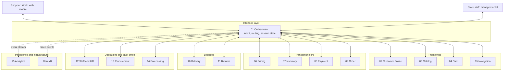
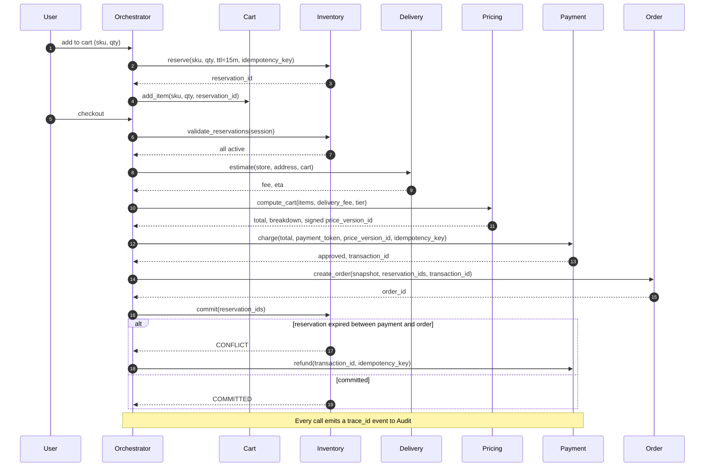

# CityMart: A 16-Agent Autonomous Retail Architecture

A hub-and-spoke multi-agent LLM architecture for running a retail store end to end: discovery, cart, pricing, payment, fulfilment, returns, replenishment, forecasting and audit.

> **Status:** Design and specification. This repository contains the architecture, per-agent specifications, system prompts, interface contracts and sequence diagrams. A runnable reference prototype is on the [roadmap](#roadmap). Nothing here claims production deployment.
>
> **Note:** All store data, SKUs and identifiers are illustrative.

---

## Why agents instead of an app?

Traditional retail software is passive: it waits for clicks and runs fixed if/then code. It struggles with requests like *"Do you have the spicy chips I bought last week, and where are they?"*, which need order history, product resolution, live stock and in-store location in one answer.

CityMart replaces that with a team of specialised agents that behave like digital store staff. They interpret intent, hand work to the right specialist, and stay bound by hard rules on price, stock, privacy and money movement.

## Architecture

All user and staff interaction goes through one **Orchestrator**. Domain agents never talk to users and never talk to each other directly.



**Hub (Orchestrator):** holds *context* (who is asking, what happened five minutes ago) but no *domain knowledge*. It cannot calculate a price or read a stock level.

**Spokes (domain agents):** hold *knowledge* (prices, stock, orders) but no *context* (they don't know who is asking or why).

## The agents

| ID | Agent | Layer | Responsibility |
|----|-------|-------|----------------|
| 01 | Orchestrator | Interface | Intent classification, routing, session state, synthesis, escalation |
| 02 | Customer Profile (CPA) | Front office | Identity, KYC, loyalty tier, privacy (GDPR/CCPA), the only agent holding raw PII |
| 03 | Catalog | Front office | Product metadata, semantic search, allergen and age-restriction flags, tax codes |
| 04 | Cart | Front office | Ephemeral session basket (Redis), linked to inventory reservations |
| 05 | Navigation | Front office | In-store wayfinding, planogram mapping, pick-list route optimisation |
| 06 | Pricing | Transaction | Price waterfall, promotion conflict resolution, tax, signed price snapshots |
| 07 | Inventory | Transaction | Physical stock, ATP calculation, soft-lock reservations, reorder triggers |
| 08 | Payment | Transaction | Tokenisation, charges and refunds via PSP, fraud and velocity checks |
| 09 | Order | Transaction | Immutable sales record, forward-only lifecycle state machine |
| 10 | Delivery | Logistics | Serviceability (geofence), fee and ETA, driver dispatch |
| 11 | Returns | Logistics | Eligibility, condition grading, RMA, refund orchestration |
| 12 | Staff & HR | Operations | Authentication, role-based overrides, escalation routing |
| 13 | Procurement | Back office | EOQ-based purchase orders, supplier management, budget gates |
| 14 | Forecasting | Back office | Demand prediction, safety stock and reorder point tuning |
| 15 | Analytics | Intelligence | KPI roll-ups, funnels, anomaly alerts (read-only, non-transactional) |
| 16 | Audit | Infrastructure | Write-once, hash-chained logging, PII scrubbing, 7-year retention |

## System constitution: four immutable laws

1. **Strict domain sovereignty.** Each fact lives in exactly one agent. The Order agent writes the receipt but must ask Pricing for the tax; if Pricing is down, the system halts rather than guesses.
2. **Zero trust, minimal assumption.** Agents trust signed proofs, not each other's intent. Inventory ignores "the user really wants this" and reserves stock only on a valid signed request.
3. **Deterministic execution.** Same input plus same world state gives the same output. No creative generation inside business logic; a cart costs the same at 10:00 and 10:01.
4. **Idempotent state changes.** Every write carries an `idempotency_key`. A key seen in the last 30 days returns the cached result and never re-executes.

## Orchestrator pipeline

Every message passes through five stages, with no skipping:

1. **Intake and triage:** classify intent and extract entities; if confidence is low or required slots are missing, ask a clarifying question instead of guessing.
2. **Validation and safety:** redact payment card numbers, block out-of-scope or malicious input.
3. **Routing:** map intent to the owning agent, attach a `trace_id`, and generate an `idempotency_key` for writes.
4. **Synthesis and conflict resolution:** validate agent responses; on disagreement, trust the most conservative signal (stock says 0, catalog says exists: do not sell).
5. **Response:** turn JSON into natural language, matched to the device (short on a kiosk, conversational on mobile).

Escalation to a human is mandatory when sentiment drops below a threshold or the same transaction fails three times.

## Checkout flow

Every call is brokered by the Orchestrator. Reservation validation and delivery estimation happen *before* pricing, so the amount charged matches the amount quoted.



## Key design decisions

**Hub-and-spoke with no peer-to-peer.** A single mediator gives one place to enforce security, tracing and ordering. The trade-off is that the Orchestrator becomes a throughput and availability concern, so it is kept stateless with session state in Redis and can be scaled horizontally.

**Orchestrator holds no domain logic.** "Never calculate a price, tax or stock level" prevents the language model from improvising business rules. Conflict precedence (for example, Inventory overrides Catalog on availability) is a configured policy, not a computation.

**Available to Promise, not on-hand.** `ATP = On_Hand - Reserved - Damaged`. Reserved stock is on the shelf but already promised to another cart, so counting it would cause double sales.

**Soft-lock reservations with a TTL.** Adding to cart creates a 15-minute reservation. If the customer doesn't pay, the lock expires and stock returns to sale. The cart keeps the item text for up to 24 hours of inactivity, marked "expired", so shoppers don't lose their list.

**Signed price snapshot.** Pricing returns a `price_version_id`, a signed hash that freezes the quote for 15 minutes. Payment verifies it, so a tampered browser value cannot change what is charged.

**Idempotency everywhere.** Networks fail and requests duplicate. Replaying a key returns the first result, which is what stops double charges and double stock deductions.

**Human-in-the-loop by design.** Agents cannot override their own rules. Price waivers, late returns and large purchase orders require a signed, scoped, time-limited override token issued by the Staff agent for a human manager.

## Failure modes and mitigations

| Risk | Mitigation | Owner |
|------|-----------|-------|
| Double charge on retry | `idempotency_key` replay cache (30 days); check status before re-asking the user | Payment |
| Overselling | ATP check plus atomic reservation; negative stock is blocked and flagged | Inventory |
| Stale cart holding stock | 15-minute reservation TTL with cleanup task | Inventory, Cart |
| Price tampering | Signed `price_version_id` verified before charge | Pricing, Payment |
| Order created after reservation lapsed | `CONFLICT` response triggers an idempotent refund | Order, Payment |
| PII leakage | Raw PII only in CPA; opaque `customer_id` and `payment_token` elsewhere; PAN redaction at intake; PII scrub before logging | CPA, Orchestrator, Audit |
| Runaway autonomous spend | Auto-approval limit; larger POs flagged `PENDING_APPROVAL` | Procurement |
| Log tampering | `hash = SHA256(previous_hash + entry)` chain on write-once storage | Audit |
| Frustrated customer or repeated failure | Sentiment and failure-count triggers create an escalation ticket | Orchestrator, Staff |
| Agents disagree on availability | Most conservative signal wins | Orchestrator |

## Global standards

- **Time:** all internal logic in UTC ISO-8601 (`YYYY-MM-DDTHH:mm:ssZ`); local time conversion happens only at the final display step.
- **Money:** decimal with precision 2, never floating point; `{ "amount": 10.00, "currency": "USD" }`.
- **Privacy:** only the Customer Profile agent stores raw PII; everyone else uses opaque identifiers.
- **Latency:** 200 ms per-agent read target, 1,500 ms end-to-end target for a conversational turn, 3,000 ms hard ceiling, with one retry after 200 ms on transient timeouts. Payment allows up to 5,000 ms for the external provider.
- **Errors:** every agent returns one schema.

```json
{
  "status": "ERROR",
  "error_code": "INSUFFICIENT_STOCK",
  "machine_message": "ATP check failed. Requested 5, available 2.",
  "human_message": "Sorry, we only have 2 of those left.",
  "trace_id": "tr-9988-xyz",
  "retryable": false
}
```

## Domain rules worth noting

- **Delivery:** serviceable only within a 15 km Haversine radius of the store; the fee is returned before pricing.
- **Returns:** 30-day window; perishables are not returnable; Grade A (new) refunds 100% and returns to sellable stock; Grade B (opened) refunds 80% and goes to open-box or damaged stock; exceptions need a manager override token.
- **Procurement:** reorder point is `(average daily demand × lead time) + safety stock`; order quantity uses EOQ; purchase orders above the auto-approval limit (default $5,000, configurable) wait for human approval.
- **Forecasting:** read-only on transactions; pushes safety stock and reorder point updates to Inventory on a schedule.

## Repository layout

```
.
├── README.md
├── docs/
│   ├── onboarding.md           # integration rules and test targets
│   ├── agents/                 # one specification per agent (01 to 16)
│   └── extras/                 # prompt-format experiment (Cart and Payment)
├── registry/
│   └── langgraph_agents.json   # agent registry: endpoints, inputs, outputs, SLAs
├── api/
│   └── openapi.yaml            # contract stubs (Inventory reserve, Payment charge)
├── diagrams/
│   ├── architecture.mermaid
│   ├── checkout-sequence.mermaid
│   └── reservation-expiry.mermaid
└── prototype/                  # planned: runnable reference implementation
```

## Roadmap

- [x] Architecture, agent specifications and system prompts
- [x] Agent registry and interface stubs
- [x] Checkout and reservation-expiry sequence diagrams
- [x] Complete the registry and specifications for all 16 agents
- [ ] Expand the OpenAPI stubs beyond Inventory reserve and Payment charge
- [ ] Reference prototype: LangGraph orchestrator with Inventory, Pricing, Payment and Order agents
- [ ] Tests: reservation expiry, promotion stacking, refund idempotency
- [ ] Cloud reference architecture (deployment mapping)

## Author

**Suhail** · [LinkedIn](https://www.linkedin.com/in/your-handle) · [GitHub](https://github.com/your-handle)

## License

Add a license of your choice (for example, MIT or CC BY 4.0) before publishing.
